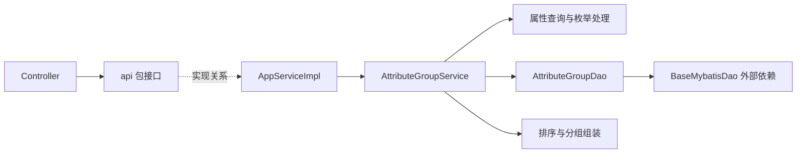

# 公司工程学习地图

核对日期：2026-10-31。以下是当前本地源码快照，供课程定位；每次真实需求开始前重新核对。四个仓库当次 `git status --short` 均为空；本次未改公司代码、未执行 Maven 构建、未启动服务或连接数据库。

## 仓库与技术证据

| 仓库 | 分支 / 提交 | 已观察依据 | 学习用途 |
| --- | --- | --- | --- |
| [udc](projects/udc/pom.xml) | test / a182384764a0 | parent 为 udc-parent:6.0.0-TEST-SNAPSHOT；含 biz/web/test/assemble/cicd/upgrade | 主业务的请求、应用服务、领域逻辑与 DAO |
| [udc-common](projects/udc-common/pom.xml) | test / d10b1bc077ab | 相同 parent；共享 DTO；测试依赖出现 JUnit 4/PowerMock | DTO、泛型包装、业务常量和基础测试 |
| [boot-extend](projects/boot-extend/pom.xml) | test / 75a13a3771a7 | parent 为 boot:6.0.0-TEST-SNAPSHOT；java.version=1.8；多种 starter | 自动装配、枚举、缓存和公司扩展约定 |
| [cdp-report](projects/cdp-report/pom.xml) | test / 9f7622a5bf65 | 相同 boot parent；core/integration/datasource/dataset/query/report/biz/web/test/assemble | 查询编排、数据源与报表链路 |

- **Java 8 语言基线**：`boot-extend/pom.xml` 第 20–26 行显式声明编译目标。其余仓库从父 POM 继承，实际构建 JDK仍需确认；不能把这一处声明扩展成四个仓库已运行验证。
- **Spring Web/Boot**：[UdcApplication](projects/udc/udc-assemble/src/main/java/com/seeyon/udc/UdcApplication.java) 与 Controller 注解、starter 自动配置为源码证据。`javax.validation` 在 DTO 中可见；具体 Boot/Spring 版本待父 POM 核实。
- **MyBatis 与公司封装**：[AttributeGroupDao](projects/udc/udc-biz/src/main/java/com/seeyon/udc/entity/domain/dao/AttributeGroupDao.java) 第 10 行继承 `BaseMybatisDao<AttributeGroup>`；不能直接当作 MyBatis-Plus 或假定每个方法都有 XML。
- **测试并存**：`boot-starter-enums` 测试有 `org.junit.Test`，`cdp-report-query` 测试有 `org.junit.jupiter.api.Test`。练习和迁移按目标模块选择，不混用注解。
- **Redis 使用点**：[EnumCacheUtils](projects/boot-extend/boot-starter-enums/src/main/java/com/seeyon/boot/starter/enums/util/EnumCacheUtils.java) 引入 `RedisTemplate`；这是特定组件使用证据，不代表每条链路必经 Redis。
- **公司契约**：`@AppService`、`@HasRole`、`SingleRequest`、`SingleResponse`、`ListResponse` 是公司层概念，先查定义/实际响应再解释完整语义。

## 链路 A：UDC 字段分组

入口方法为 `AttributeGroupController#selectListByEntityId`。类级路由为 `StandardAppId.UDC + "/attribute-group"`，方法路由为 `GET {entityId}`；常量值及部署前缀未在本次展开确认，不拼造完整请求 URL。

| 顺序 | 源码与位置 | 看什么 |
| --- | --- | --- |
| 1 | [AttributeGroupController](projects/udc/udc-web/src/main/java/com/seeyon/udc/controller/AttributeGroupController.java)，13、30–37、75–79 行 | import 来自 `com.seeyon.udc.api`；路由、角色注解、参数包装 |
| 2 | [api.AttributeGroupAppService](projects/udc/udc-biz/src/main/java/com/seeyon/udc/api/AttributeGroupAppService.java)，14、67 行 | 接口方法接受 `SingleRequest<Long>`，返回 `ListResponse<AttributeGroupDto>` |
| 3 | [AttributeGroupAppServiceImpl](projects/udc/udc-biz/src/main/java/com/seeyon/udc/appservice/AttributeGroupAppServiceImpl.java)，8、33–39、127–128 行 | implements 正确接口；取出 data，传 `containHidden=false`，包装结果 |
| 4 | [AttributeGroupService](projects/udc/udc-biz/src/main/java/com/seeyon/udc/entity/domain/service/AttributeGroupService.java)，772 行起 | 先查属性、补枚举显示值，再查分组；过滤隐藏字段、排序、处理空分组与虚拟分组 |
| 5 | [AttributeGroupDao](projects/udc/udc-biz/src/main/java/com/seeyon/udc/entity/domain/dao/AttributeGroupDao.java)，10 行 | 继承基础 DAO；Service 中使用 `selectListByWrapper` |
| 6 | [AttributeGroupDto](projects/udc-common/src/main/java/com/seeyon/udc/common/dto/AttributeGroupDto.java) | 观察跨模块 DTO 和列表返回，不把持久化实体直接等同于响应 |

**定位陷阱**：另有 [appservice.AttributeGroupAppService](projects/udc/udc-biz/src/main/java/com/seeyon/udc/appservice/AttributeGroupAppService.java)，它是同名类，处理另一组操作。此次 Controller 导入的是 `api` 包的接口。IDE 跳转、`import`、方法签名优先于文件名猜测。

上述是静态调用关系。实际 Bean/代理选择、权限拦截、最终 SQL 与数据库结果尚未运行核验；后续在 M05/M07/M08 取得证据。

## 链路 B：boot-extend 枚举组件

1. [spring.factories](projects/boot-extend/boot-starter-enums/src/main/resources/META-INF/spring.factories) 指向 `EnumsAutoConfiguration`。
2. [EnumsAutoConfiguration](projects/boot-extend/boot-starter-enums/src/main/java/com/seeyon/boot/starter/enums/EnumsAutoConfiguration.java) 第 7–10 行使用 `@Configuration`、`@EnableConfigurationProperties`、`@ConditionalOnProperty`。
3. [CtpEnumDao](projects/boot-extend/boot-starter-enums/src/main/java/com/seeyon/boot/starter/enums/domain/dao/CtpEnumDao.java) 与 [EnumCacheUtils](projects/boot-extend/boot-starter-enums/src/main/java/com/seeyon/boot/starter/enums/util/EnumCacheUtils.java) 用于观察持久化和缓存边界。

优先学“配置如何使组件出现、业务如何调用”。这个配置类本身很薄；不要推断它展示了全部 Bean 扫描、权限和缓存生命周期。

## 链路 C：cdp-report 查询统计

| 顺序 | 源码与方法 | 阅读边界 |
| --- | --- | --- |
| 1 | [QueryStatisticsExecuteController](projects/cdp-report/cdp-report-web/src/main/java/com/seeyon/cdp/report/controller/querystatistics/QueryStatisticsExecuteController.java) `query`，68–71 行 | POST query；请求体到 SingleRequest |
| 2 | [QueryStatisticsExecuteAppService](projects/cdp-report/cdp-report-report/src/main/java/com/seeyon/cdp/report/querystatistics/appservice/QueryStatisticsExecuteAppService.java) `query/run`，68–81 行 | prepareSaved 准备上下文，再交执行器 |
| 3 | [QueryStatisticsQueryExecutor](projects/cdp-report/cdp-report-report/src/main/java/com/seeyon/cdp/report/querystatistics/execute/QueryStatisticsQueryExecutor.java) `execute`，58–95 行 | 状态短路、命令组装、网关与钻取分支、耗时记录 |
| 4 | [QueryEngineGateway](projects/cdp-report/cdp-report-report/src/main/java/com/seeyon/cdp/report/querystatistics/execute/gateway/QueryEngineGateway.java) / [DefaultQueryEngineGateway](projects/cdp-report/cdp-report-report/src/main/java/com/seeyon/cdp/report/querystatistics/execute/gateway/DefaultQueryEngineGateway.java)，35 行起 | 将命令转为统计/明细查询，并适配返回 |
| 5 | [QueryEngine](projects/cdp-report/cdp-report-query/src/main/java/com/seeyon/cdp/report/query/QueryEngine.java) | `statQuery/detailQuery` 为本次静态追踪边界，完整 SQL/JDBC 路径留给 M11 |

先追一条明细查询或统计查询，不同时阅读整个报表引擎。查询准备中的数据权限、实际数据源、执行 SQL 和最终序列化分别验证。

## 缺失与进入公司环境的前置检查

当前 `projects/` 可见四个仓库。POM/README 提到的 `udc-parent`、`boot`、`udc-facade`、`udc-plugin-api`、`cdp-report-facade`、`cdp-common` 等是依赖线索，不据此断言存在同名 Git 仓库；基础 web/appservice/mybatis/security starter 的完整实现也不在本次源码覆盖内。

在开始公司运行练习时，先确认父 POM 与私服访问、实际 JDK/依赖版本、数据库与方言、配置、身份来源及必要服务。只记录必要错误信息，避免把 settings 中凭据写入学习材料。

UDC 的 [AGENTS.md](projects/udc/AGENTS.md) 要求从 [CONTEXT-MAP.md](projects/udc/CONTEXT-MAP.md) 进入领域；本地迭代可使用 `fast-local-compile`，最终交付或公开签名变更按其说明执行完整构建。本次只记录入口，没有运行这些命令。
